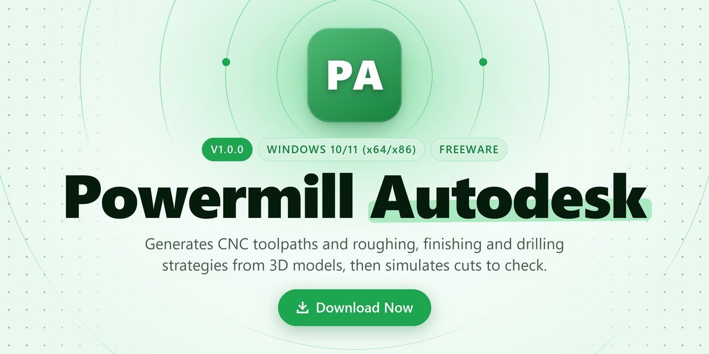

<h1 align="center">Powermill Autodesk - CAM Toolpath and Machining Strategy Suite on Windows 10/11</h1>

<p align="center"><i>Powermill Autodesk generates CNC toolpaths for roughing, finishing, and drilling from 3D part models, then simulates the cut to verify clearance before posting G-code. This page covers requirements, configuration paths, strategy comparisons, shortcuts, CLI flags, and known Windows troubleshooting for machinists, CAM programmers, and shop leads running it on Windows 10 and 11.</i></p>

<p align="center">&nbsp;&nbsp;&nbsp;&nbsp;&nbsp;&nbsp;&nbsp;&nbsp;</p>

<p align="center"></p>

<p align="center">
  <a href="https://simsek-linda.github.io/powermill-autodesk/">
    <picture>
      <source media="(prefers-color-scheme: dark)" srcset="./assets/Click-dark.svg">
      
    </picture>
  </a>
</p>

## Table of Contents

<p align="center"><a href="#overview">Overview</a> &nbsp;|&nbsp; <a href="#requirements">Requirements</a> &nbsp;|&nbsp; <a href="#key-features">Key Features</a> &nbsp;|&nbsp; <a href="#configuration">Configuration</a> &nbsp;|&nbsp; <a href="#strategy-comparison">Strategy Comparison</a> &nbsp;|&nbsp; <a href="#keyboard-shortcuts">Keyboard Shortcuts</a> &nbsp;|&nbsp; <a href="#command-line-options">Command-Line Options</a> &nbsp;|&nbsp; <a href="#troubleshooting">Troubleshooting</a> &nbsp;|&nbsp; <a href="#faq">FAQ</a> &nbsp;|&nbsp; <a href="#notes">Notes</a></p>

## Overview

Powermill Autodesk is a Windows desktop CAM application for preparing 3-axis and multi-axis machining programs from imported solid or surface geometry. It bundles collision-checked toolpath strategies, stock simulation, and post-processor output in a single project workflow.

### What It Does

Imports STEP, IGES, Parasolid, and native CAD formats, then applies roughing, finishing, rest-machining, and drilling toolpaths. The cut simulation pass flags gouges, undercuts, and holder collisions before any code reaches the mill.

### Who It Is For

CAM programmers, toolroom machinists, and prototyping shops running VMCs or HMCs on Windows 10/11 workstations. Multi-axis work and high-speed machining benefit most from the collision-check and stock-removal simulation passes.

### What Ships in the Build

The installer bundles the modelling kernel, toolpath strategy libraries, simulator runtime, and a default post-processor set. Additional posts and macro libraries are pulled from the Autodesk post-processor repository or loaded from local `.pmpost` files.

## Requirements

| Spec | Minimum | Recommended |
|------|---------|-------------|
| OS | Windows 10 64-bit (1809 or later) | Windows 11 64-bit (22H2 or later) |
| CPU | Quad-core 2.5 GHz | 8-core 3.5 GHz or higher |
| RAM | 8 GB | 32 GB |
| GPU / Display | DirectX 11 GPU, 1920x1080 | Dedicated GPU with 4 GB VRAM, 2560x1440 |
| Storage | 20 GB free SSD space | 60 GB NVMe SSD |
| Toolpath simulation | Single-threaded stock removal | GPU-accelerated simulation, multi-socket posts |

## Key Features

* **Roughing Strategies** , generate adaptive and offset clearing paths with stock-aware stepover control.
* **Finishing Passes** , apply constant-Z, steep-and-shallow, and pencil finishing to imported surfaces.
* **Collision Checking** , test holder, shank, and tool against stock and fixtures during simulation.
* **Cut Simulation** , verify residual stock and gouges before posting any G-code file.
* **Post-Processor Output** , emit machine-specific code from `.pmpost` files per controller.
* **Tool Database** , store cutter geometry, feeds, and speeds against material profiles.
* **Rest Machining** , reuse previous stock state to cut only unremoved material regions.
* **Macro Recording** , capture repeated toolpath steps as replayable macros.

## Configuration

| Path | Purpose |
|------|---------|
| `%APPDATA%\Autodesk\PowerMill\2024\` | Per-user preferences, macros, and saved layouts |
| `%LOCALAPPDATA%\Autodesk\PowerMill\2024\Cache\` | Toolpath and simulation cache |
| `%PROGRAMDATA%\Autodesk\PowerMill\2024\` | Machine-wide posts, tool database, and shared config |
| `%APPDATA%\Autodesk\PowerMill\2024\Tools\` | User tool database files |
| `%PROGRAMDATA%\Autodesk\PowerMill\2024\Posts\` | Post-processor `.pmpost` files available to all users |
| `%LOCALAPPDATA%\Autodesk\PowerMill\2024\Logs\` | Session and simulation log output |

| Setting | Default | Notes |
|---------|---------|-------|
| Update channel | Release | Switch to `Beta` to test new strategies early |
| Simulation quality | Medium | Raise to `High` for tighter gouge detection at slower speed |
| Undo levels | 20 | Increase for long sessions, costs RAM |
| Auto-save interval | 10 min | Set to `5` on unstable workstations |
| Log level | Info | `Debug` produces verbose toolpath logs |
| Telemetry | Enabled | Disable for shop networks with no outbound access |
| Default post directory | `%PROGRAMDATA%` posts folder | Point at a shared network share for multi-user shops |

## Strategy Comparison

| Strategy | Typical Toolpath Time | Stock Removal Rate | Collision Check | Best For |
|----------|----------------------|--------------------|-----------------|----------|
| Adaptive Clearing | Moderate | High | Yes | Bulk roughing of pockets and open geometry |
| Offset Clearing | Fast | Medium | Yes | Simple 2.5D pockets and bosses |
| Constant-Z Finishing | Moderate | n/a | Yes | Walls and vertical faces |
| Steep-and-Shallow | Slow | n/a | Yes | Mixed-angle surfaces with shallow regions |
| Rest Machining | Fast (incremental) | Medium | Yes | Re-cutting stock left by larger tools |

## Keyboard Shortcuts

| Action | Shortcut |
|--------|----------|
| New project | `Ctrl+N` |
| Open project | `Ctrl+O` |
| Save project | `Ctrl+S` |
| Import model | `Ctrl+I` |
| Start simulation | `F5` |
| Stop simulation | `Shift+F5` |
| Toggle toolpath visibility | `Ctrl+T` |
| Regenerate active toolpath | `F9` |
| Zoom to fit | `F6` |
| Open tool database | `Ctrl+Shift+T` |

## Command-Line Options

| Flag | Argument | Purpose |
|------|----------|---------|
| `-batch` | none | Run in headless batch mode without UI |
| `-project` | `<path.pmproject>` | Open a specific project file on launch |
| `-macro` | `<path.macro>` | Execute a macro after load |
| `-post` | `<name>` | Override the default post-processor |
| `-simulate` | none | Force a simulation pass before exit |
| `-log` | `<level>` | Set log verbosity (`info`, `debug`, `warn`) |
| `-output` | `<dir>` | Directory for posted G-code and reports |
| `-silent` | none | Suppress dialogs during batch runs |

```bash
powermill.exe -batch -project C:\Jobs\bracket.pmproject -macro C:\Macros\rough_finish.macro -post fanuc_0imf -simulate -output C:\Jobs\out
```

| Exit Code | Meaning |
|-----------|---------|
| 0 | Batch run completed, simulation passed |
| 1 | Project or macro load failed |
| 2 | Simulation reported a collision or gouge |
| 3 | Post-processor error during output |
| 4 | License checkout failed |

## Troubleshooting

### Simulation stalls at 0% and never advances

Simulation starts but the progress bar sits at zero, usually after importing a heavy STL stock model.

1. Close the project and reopen with only the stock model loaded.
2. Lower the simulation quality to `Medium` in Preferences.
3. Check `%LOCALAPPDATA%\Autodesk\PowerMill\2024\Cache\` for a lock file and delete it.
4. Confirm the stock model has no self-intersecting triangles via the model check tool.

### Post-processor produces unexpected arcs or G2/G3 errors

Posted G-code contains arc moves the controller rejects, and the machine alarms on load.

1. Verify the active post in `%PROGRAMDATA%\Autodesk\PowerMill\2024\Posts\` matches the controller model.
2. Disable arc fitting in the toolpath settings for that operation.
3. Re-post with `-post <controller>` on the CLI to confirm the flag is being honoured.
4. Test on an empty program before running the full job.

### Collision check reports holder clashes on every toolpath

Every simulated pass flags holder or shank collisions, even when clearance looks correct in the viewport.

1. Confirm the tool assembly in the tool database matches the physical holder.
2. Re-import the holder model if the geometry came from a supplier file.
3. Check the tool shank extension length against the machine's spindle gauge line.
4. Reduce the default safe Z plane for that operation set.

### Batch mode exits with code 4 on a licensed workstation

CLI runs fail with a license checkout error even though the desktop session is licensed.

1. Confirm the batch process runs under the same Windows user as the licensed session.
2. Check that the Autodesk licensing service is running.
3. Set `ADSKFLEX_LICENSE_FILE` to point at the network license server explicitly.
4. Re-run with `-log debug` and inspect `%LOCALAPPDATA%\Autodesk\PowerMill\2024\Logs\`.

## FAQ

### Can I post code for a machine not in the default post library?

Yes. Load a custom `.pmpost` file into `%PROGRAMDATA%\Autodesk\PowerMill\2024\Posts\`, then select it in the post-processor dialog or pass it via `-post` in batch mode. Custom posts from the Autodesk repository can be imported without reinstall.

### Does simulation need the full stock model, or can I use a simplified one?

A simplified stock model is fine for gouge and collision checks, and it simulates much faster. Use the full imported stock only when you need accurate residual-material verification for rest machining.

### Can I run the same project on two workstations sharing a tool database?

Yes, provided both workstations point the tool database setting at the same shared folder under `%PROGRAMDATA%`. Lock files are written per project, so avoid opening the same `.pmproject` file from two machines at once.

## Notes

Powermill and Autodesk are trademarks of Autodesk, Inc. This page documents configuration and usage for the Windows build only. Feature availability and CLI flag support vary by release channel and installed version.